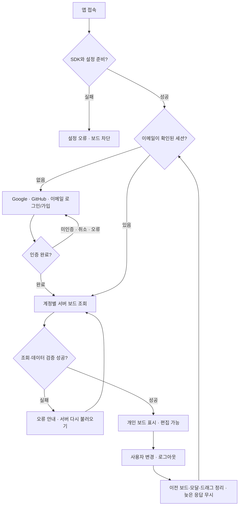

# User Flow — 인증·사용자별 칸반보드

## 첫 진입·인증·보드 복원

Google/GitHub는 Supabase의 PKCE OAuth와 계정 선택 화면을 요청한다. 처음 인증하면 계정이 생성된다. 이메일 가입은 비밀번호·확인 일치 검사 → 가입 확인 메일 안내 → 같은 브라우저의 링크 확인 → 로그인으로 진행한다. 인증 메일 재발송을 제공하고 미인증 계정은 보드를 열지 않는다. 모의 인증 E2E와 실제 계정의 외부 제공자 로그인 검증을 구분한다.

## 카드 관리·이동·저장

| 작업 | 사용자 흐름 | 취소·오류 |
|---|---|---|
| 추가 | 추가 버튼 → 제목·선택 설명 → 저장 → 서버 확정 후 To-Do 마지막 | 공백 제목 거부, 취소·Escape는 생성하지 않음 |
| 수정 | 기존 내용 모달 → 변경 → 저장 → 서버 확정 후 내용 갱신·위치 유지 | 취소·Escape는 원본 보존 |
| 삭제 | 삭제 버튼 → 확인 → 서버 확정 후 제거 | 취소·Escape는 원본 보존 |
| 드래그 | 핸들 8px 이상 이동 → 삽입 표시·자동 스크롤 → 컬럼 안에 놓기 → RPC 저장 | Escape·영역 밖·pointercancel은 저장하지 않음 |
| 상태 메뉴 | 다른 상태 선택 → 대상 끝으로 저장·포커스·알림 | 현재 상태 재선택은 순서 유지 |

저장 중에는 중복 편집·제출을 막는다. 서버 요청 실패·시간 초과·버전 충돌에서는 이전 확정 보드를 유지하고 “서버에서 다시 불러오기”를 요구한다. 저장이 실패했다고 브라우저 로컬 저장으로 바꾸지 않는다. 세션이 종료되면 저장 응답이 나중에 도착해도 보드를 다시 표시하지 않는다.

## 이전 브라우저 보드

로그인 후 서버 보드가 비어 있고 이전 localStorage 보드가 유효하면 가져오기 안내를 표시한다. 사용자 확인 후 서버에 저장하며, 가져오는 동안 추가·편집·재조회를 막는다. 성공하면 서버 보드를 표시하고 브라우저 원본은 보존한다. 기존 todo 데이터는 가져오기 대상이 아니다.

## E2E 추적표

각 테스트는 독립 BrowserContext로 실행한다. 정상·취소·오류를 별도 사례로 검증하고 제목에 UF ID를 포함한다. desktop은 마우스, mobile은 실제 Chromium CDP touch 경로를 사용한다.

| UF | 필수 동작 | 테스트 위치 |
|---|---|---|
| UF-01 | 인증·화면 준비 전 조작 차단, 로그인 후 처음 빈 보드·카드 수 | cards.spec.js |
| UF-02 | 제목·설명·공백 검증·추가 취소·HTML 텍스트 표시 | cards.spec.js |
| UF-03 | 수정·취소·순서 유지·포커스 복원 | cards.spec.js |
| UF-04 | 삭제 취소·확인·전체 빈 상태·포커스 | cards.spec.js |
| UF-05 | 6방향 이동·빈 컬럼·앞뒤 재정렬·서버 저장 | drag.spec.js |
| UF-06 | 시작 기준 미달·Escape·영역 밖·cancel의 상태·저장 불변 | drag.spec.js |
| UF-07 | 상태 메뉴·현재 상태 재선택·키보드·aria-live | cards.spec.js |
| UF-08 | 클라우드 CRUD·내용·상태·순서 reload 복원 | storage.spec.js, drag.spec.js |
| UF-09 | 서버 보드 형식·버전·중복 ID 오류에서 접근 차단·자동 덮어쓰기 방지 | storage.spec.js |
| UF-10 | 서버 요청 실패·충돌·미설정·재조회 복구 | storage.spec.js |
| UF-11 | Materialize 오류 안내·변경 없음·실제 CDN smoke | storage.spec.js, cdn.spec.js |
| UF-12 | 4개 너비·44px·긴 텍스트·모달·Tab·reduced motion·일반/자동 스크롤 | layout.spec.js, drag.spec.js |
| UF-13 | 비로그인 보드 차단·제공자 표시·SDK 오류·운영 공개 설정 smoke | auth.spec.js, cdn.spec.js |
| UF-14 | 이메일 가입·확인 입력·인증 대기·재발송·미인증 거부·세션 복원 | auth.spec.js |
| UF-15 | Google/GitHub 계정 선택·PKCE·복귀 주소·취소 복귀 | auth.spec.js |
| UF-16 | 로그아웃·A/B 전환·원래 보드 복원·다른 탭의 세션 종료와 늦은 응답 | auth.spec.js |
| UF-17 | 명시적 이전 보드 가져오기·원본 보존·진행 중 동시 편집 차단 | auth.spec.js |

테스트 파일은 e2e/ 아래에 있다. auth.spec.js는 외부 인증/API를 테스트 경계에서 대체하되 실제 Supabase SDK를 실행한다. cdn.spec.js의 공개 설정 smoke는 실제 프로젝트의 Provider 설정만 읽고 계정 생성·메일 발송을 하지 않는다. 실제 외부 계정 인증과 운영 DB 격리는 [AUTH_SETUP](AUTH_SETUP.md)의 실계정 확인 항목으로 남긴다.

## Test-first 실행 기록 원칙

기대 테스트 먼저 작성·실행 → 실제 assertion Red 확인 → 최소 구현 Green → 필요한 Refactor → Jest/E2E 전체 재검증을 수행한다. 기존 동작의 처음부터 통과한 기준선과 테스트 도구·환경 실패는 제품 Red와 구분한다. 명령·실패 원인·Green·산출물은 [WORKFLOW](WORKFLOW.md)에 기록한다.

관련 계약은 [PRD](PRD.md), [TRD](TRD.md), [DATABASE_DESIGN](DATABASE_DESIGN.md), 상태는 [TASK](TASK.md)를 따른다.

## 운영 게시 기준

- 저장소: [https://github.com/YangSeungYeol/KanbanBoard](https://github.com/YangSeungYeol/KanbanBoard), 운영 주소: [https://yangseungyeol.github.io/KanbanBoard/](https://yangseungyeol.github.io/KanbanBoard/). GitHub Pages main 브랜치 루트에서 정적 파일을 제공한다.
- 최신 자동 테스트 기준은 Jest 84개·Playwright 92개이며 실제 배포 상태는 [DEPLOY](DEPLOY.md)를 따른다.
- Pages 화면 접속과 실제 계정 인증·이메일 수신·운영 데이터 CRUD는 구분한다. 운영 인증 복귀 주소에 `https://yangseungyeol.github.io/KanbanBoard/`를 추가하고 기존 todo 주소는 유지한다.

## 게시 확인 — 2026-11-12

운영 주소: [https://yangseungyeol.github.io/KanbanBoard/](https://yangseungyeol.github.io/KanbanBoard/). [앱 소스 6185f0a](https://github.com/YangSeungYeol/KanbanBoard/commit/6185f0a03784d7814cea16d10ea00ad84eef1311)의 [Pages 배포](https://github.com/YangSeungYeol/KanbanBoard/actions/runs/43162571976) 성공과 공개 데스크톱·모바일 로그인 화면·런타임 7개 원본 일치를 확인했다. 배포 전 Jest 84개·E2E 92개가 통과했다. Pages 설정과 Supabase 복귀 주소 등록은 사용자 완료 확인을 받았다. 실제 계정 동의·메일 수신·운영 데이터 CRUD는 별도 검증 범위다. 최신 배포 절차·증거는 [DEPLOY](DEPLOY.md)를 따른다.
